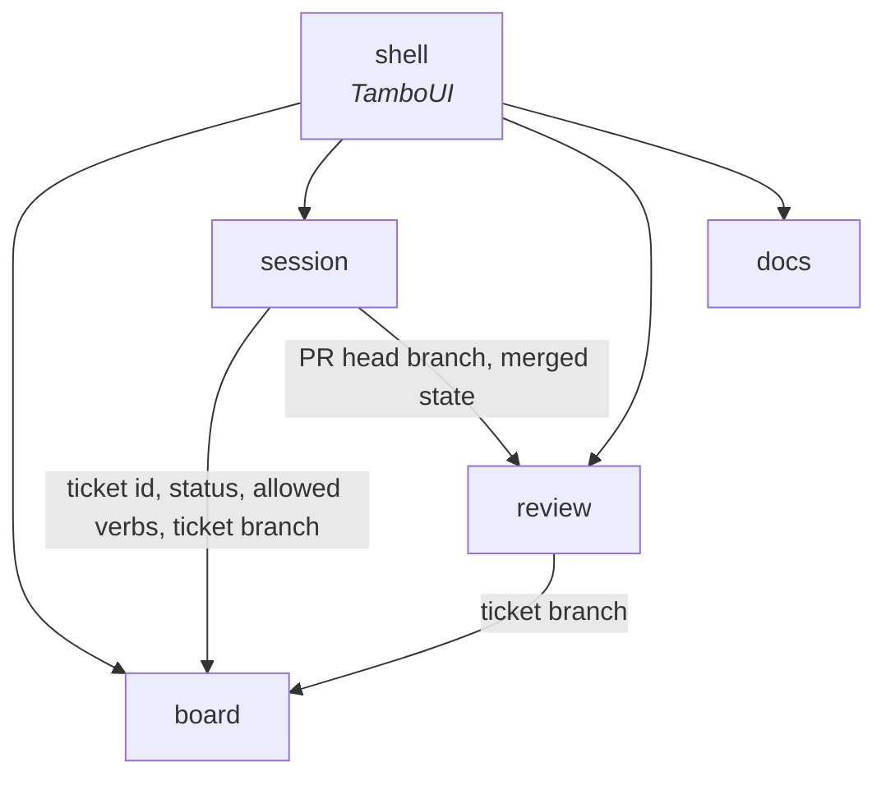

# Context map

Each bounded context is a direct subpackage of `dev.maxenceng.lazyclaude` whose `package-info` declares it `@ApplicationModule(type = CONTEXT)`. Boundaries are
verified by `ArchitectureTest`, so this document describes intent while the test enforces it.

## Contexts

`board`, `docs` and `session` exist in code. The others become real — package, glossary section and all — in the
change that implements the first ticket refined into them. Their words are already in
`docs/glossary.md`, marked *expected*.

| Context | Responsibility | Status |
|---|---|---|
| `board` | A project's backlog: its tickets, their status read from each ticket branch's copy, and the verbs `/ticket` allows for that status. Read-only. Today it reads each ticket from the project's working tree; branch copies and verbs come later. | in code |
| `session` | Claude Code sessions: which are live (from the registry after a liveness check, else `claude agents --json`) and their state (busy, your turn, waiting), kept current by its own watcher on `~/.claude/sessions/` (ADR 0021). Still to come: linking them to tickets, the preselected verb, ticket worktrees, hosting sessions on a pty, desktop notifications. Read-only. | in code |
| `review` | A ticket's pull request: its diff and threads, your pending review on GitHub, submitting it, and whether it is merged. | expected |
| `docs` | The project's `docs/**/*.md` outside `docs/backlog/`, as a tree of documents, read-only, kept current by its own watcher on `docs/**` (ADR 0016). | in code |

Not contexts:

| Package | Role |
|---|---|
| `shell` | The TamboUI application. Asks each context through the `*Query` in its `infrastructure.primary`, which answers `*View`s made of the context's `published` value objects (ADR 0011, ADR 0012), composing them into screens and keys, and joins them: a ticket's marker is the strongest state among its linked sessions. |
| `shared` | Shared kernel. In `shared.domain` (ADR 0010): `Project`, the main worktree's root that `board`, `docs`, `session` and `review` all work in, and what locates it: `ProjectLocatorPort`, `WorkingDirectory`, `ProjectNotFoundException` and `ProjectUnavailableException` (ADR 0019). In `shared.infrastructure.secondary` (ADR 0017): `Utf8Text`, the decoding both `board`'s and `docs`' adapters read files with, and `ProjectLocatorRepository`, the git lookup `board` and `session` share (ADR 0019). Warnings (ADR 0022): `Warning`, `WarningPort` and `WarnOnce`, raised by the `docs` and `session` managers; `WarningRepository` holds them. The read side (`Warnings`, `WarningWatchPort`, `WarningManager`) is the shell's alone, through `WarningQuery`; the composition root raises one for a stopped thread through `WarningCommand`. |
| `error` | Error kernel: `DomainException`, its status, and `Assert` (in `error.domain`, ADR 0011). |

## Relationships

- `board` knows nothing of sessions or pull requests. Who works a ticket is `session`'s
  question; how a ticket looks with its sessions is `shell`'s join.
- `session` reads a pull request's head branch to apply the `pr-link` rule, and its state to
  preselect `done`.
- `review` finds a ticket's pull request by its ticket branch.
- A ticket's PR glyph on the board is `shell`'s join of its ticket branch with `review`'s open
  pull requests and their CI result; `board` still knows nothing of pull requests.
- Which ticket branches stop being a status source is `review`'s merged state, handed to
  `board`'s status read by `shell` as plain branch names.
- `docs` stands alone. The shell hands it the project root that `board` located (ADR 0015).
- `session` stands alone too: the shell hands it the same root, and it asks the shared locator which project each session's `cwd` is in (ADR 0019).
