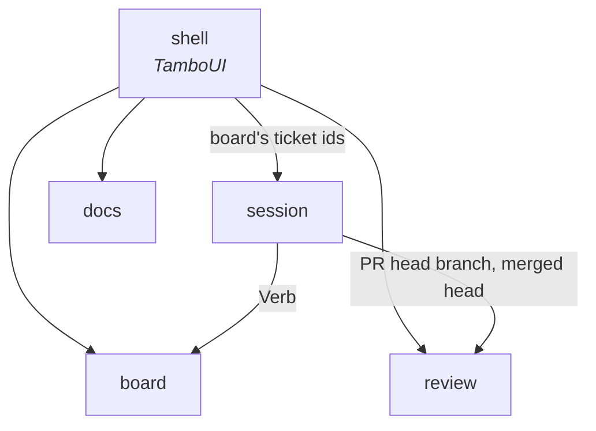

# Context map

Each bounded context is a direct subpackage of `dev.maxenceng.lazyclaude` whose `package-info` declares it `@ApplicationModule(type = CONTEXT)`. Boundaries are
verified by `ArchitectureTest`, so this document describes intent while the test enforces it.

## Contexts

`board`, `docs`, `review` and `session` exist in code. The others become real — package, glossary section and all — in the
change that implements the first ticket refined into them. Their words are already in
`docs/glossary.md`, marked *expected*.

| Context | Responsibility | Status |
|---|---|---|
| `board` | A project's backlog: its tickets, their status read from each ticket branch's copy, and the verbs `/ticket` allows for that status. Read-only. A ticket is its branch copy, found through `git worktree list` and `git show`, unless its root copy reads `done` (ADR 0028) or its branch is among the merged ones the shell hands over. Kept current by its own watch on the root `docs/backlog/`, each worktree's copy of its ticket's file, and the refs (ADR 0031). The verbs `/ticket` allows for each ticket, `design` included when its branch touches `frontend/**`. | in code |
| `session` | Claude Code sessions: which are live (from the registry after a liveness check, else `claude agents --json`) and their state (busy, your turn, waiting), kept current by its own watcher on `~/.claude/sessions/` (ADR 0021); and which are past, from the transcripts under `~/.claude/projects/` through a cache of their own, kept current by a second watcher (ADR 0023). Each is linked to the tickets its `/ticket` args name, else weakly to those its branch names, against the ticket ids the shell hands over (ADR 0024). It also hosts the sessions lazyclaude starts: the real `claude` on a pty, as `HostedSession`s behind a `HostPort` whose one adapter holds pty4j and jediterm (ADR 0026). It picks the verb a ticket's new session starts on and runs it in the ticket worktree, which it adds when missing (ADR 0030) and removes on the user's yes when nothing stands in it (ADR 0038). It lists only the live sessions whose pid it hosts, so a `claude` in another terminal shows nowhere, and notifies the desktop when a live session of the project enters waiting, unless the shell says it is the watched one (ADR 0033) or `config.yml` turns notifications off. It owns lazyclaude's own configuration, `config.yml`: the reserved chords, published for the shell to match keys and draw the key bar, and the notification switch; and it warns when Claude Code's `~/.claude/keybindings.json` binds a reserved chord. | in code |
| `review` | A ticket's pull request: its open pull requests and the CI result of their checks, and the 100 most recent merged pull requests with the commit each was merged at, from two `gh pr list` runs in turn on a 60 s timer of its own, matched by the shell to a ticket's branch. Also, on demand for one pull request, its diff (`gh pr diff`) and its review threads (`gh api graphql`), each read when the shell asks (ADR 0039). Also your pending review of one pull request, the one write (ADR 0009): read, with the pull request's head, in one query, and written comment by comment, then submitted as a Comment (ADR 0041). | in code |
| `docs` | The project's `docs/**/*.md` outside `docs/backlog/`, as a tree of documents, read-only, kept current by its own watcher on `docs/**` (ADR 0016). | in code |

Not contexts:

| Package | Role |
|---|---|
| `shell` | The TamboUI application. Asks each context through the `*Query` in its `infrastructure.primary`, which answers `*View`s made of the context's `published` value objects (ADR 0011, ADR 0012), composing them into screens and keys, and joins them: `p` on a ticket whose branch heads an open pull request opens its review, reading the diff and threads from `review` (ADR 0039); it hands `session` the board's ticket ids, and a ticket's marker is the strongest among its linked live sessions, and its PR glyphs come from matching its ticket branch to the head of an open pull request; when the ticket branches among the merged pull requests' heads change, or `board`'s watch reports a change, it reads `board` again with them and hands `session` the ids it finds; `R` asks `board`, `docs`, `review` and `session` for everything at once. It also tracks the terminal's focus, through a backend that strips focus reports from TamboUI's input (ADR 0034), and tells `session` which session is in view. |
| `sidecar` | *Expected* (ADR 0050). The backend run as a child of the desktop frontend: `lazyclaude --sidecar` composes the contexts as the shell does, through each `infrastructure.primary` and `published`, and speaks JSON-RPC 2.0 over JSON Lines on stdin and stdout, the Views serialized by Jackson. Nothing depends on it. |
| `frontend/` | *Expected* (ADR 0057). The desktop frontend, outside the Java tree: a Tauri relay in `src-tauri/` and React over xterm.js in `src/`, one folder per context it draws, driving a sidecar through a TypeScript client generated from `docs/protocol/`. Its tickets carry `DESKTOP`. |
| `shared` | Shared kernel. In `shared.domain` (ADR 0010): `Project`, the main worktree's root, and the path rule for a ticket's worktree on a `BranchName`, that `board`, `docs`, `session` and `review` all work in, and what locates it: `ProjectLocatorPort`, `WorkingDirectory`, `ProjectNotFoundException` and `ProjectUnavailableException` (ADR 0019). In `shared.infrastructure.secondary` (ADR 0017): the tree watcher `board` and `docs` both watch with (ADR 0031), and its watch service state (`WatchServiceFactory`, `WatchServiceState`: `Watching | NotWatching`) that `session`'s registry and transcript watchers start from too (ADR 0045), `Utf8Text`, the decoding both `board`'s and `docs`' adapters read files with, and `ProjectLocatorRepository`, the git lookup of the project `board` and `session` share (ADR 0019); `board`'s branch-copy reads run their own git. Warnings (ADR 0022): `Warning`, `WarningPort` and `WarnOnce`, raised by the `board`, `docs` and `session` managers; `WarningRepository` holds them. The read side (`Warnings`, `WarningWatchPort`, `WarningManager`) is the shell's alone, through `WarningQuery`; the composition root raises one for a stopped thread through `WarningCommand`. |
| `error` | Error kernel: `DomainException`, its status, and `Assert` (in `error.domain`, ADR 0011). |

## Relationships

- `board` knows nothing of sessions or pull requests. Who works a ticket is `session`'s
  question; how a ticket looks with its sessions is `shell`'s join.
- `session` is handed the board's ticket ids and a ticket's allowed verbs by the shell, and reads only `Verb` from `board.published` (ADR 0030); the ticket's status and branch stay `board`'s. It reads a pull request's head branch to apply the `pr-link` rule, and the shell hands it whether a ticket's branch is among the merged heads, to
  preselect `done`, and the ticket branch's merged head (`MergedHead`), to tell what a merge covered before a worktree is removed (ADR 0038).
- `review` knows nothing of tickets: it reads every open pull request, and the shell finds a ticket's by its ticket branch.
- A ticket's PR glyph on the board is `shell`'s join of its ticket branch with `review`'s open
  pull requests and their CI result; `board` still knows nothing of pull requests.
- Which ticket branches stop being a status source is `review`'s merged state, handed to
  `board`'s status read by `shell` as plain branch names.
- `docs` stands alone. The shell hands it the project root that `board` located (ADR 0015).
- `session` stands alone too: the shell hands it the same root, and it asks the shared locator which project each session's `cwd` is in (ADR 0019).
