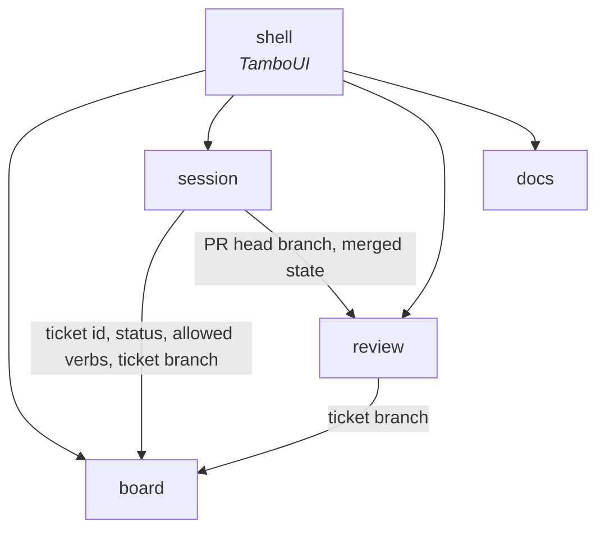

# Context map

Each bounded context is a direct subpackage of `dev.maxenceng.lazyclaude`. Boundaries are
verified by `ArchitectureTest`, so this document describes intent while the test enforces it.

## Contexts

`board` exists in code. The others become real — package, glossary section and all — in the
change that implements the first ticket refined into them. Their words are already in
`docs/glossary.md`, marked *expected*.

| Context | Responsibility | Status |
|---|---|---|
| `board` | A project's backlog: its tickets, their status read from each ticket branch's copy, and the verbs `/ticket` allows for that status. Read-only. Today it reads each ticket from the project's working tree; branch copies and verbs come later. | in code |
| `session` | Claude Code sessions: which exist and their state (busy, your turn, waiting), linking them to tickets, the preselected verb, ticket worktrees, hosting sessions on a pty, desktop notifications. | expected |
| `review` | A ticket's pull request: its diff and threads, your pending review on GitHub, submitting it, and whether it is merged. | expected |
| `docs` | The project's `docs/**/*.md` outside `docs/backlog/`, as a tree of documents, read-only. | expected |

Not contexts:

| Package | Role |
|---|---|
| `shell` | The TamboUI application. Composes contexts' application services into screens and keys, and joins them: a ticket's marker is the strongest state among its linked sessions. |
| `shared` | Shared kernel. Its first type is `Project` (in `shared.domain`, ADR 0010), the main worktree's root that `board`, `session` and `review` all work in. |

## Relationships

- `board` knows nothing of sessions or pull requests. Who works a ticket is `session`'s
  question; how a ticket looks with its sessions is `shell`'s join.
- `session` reads a pull request's head branch to apply the `pr-link` rule, and its state to
  preselect `done`.
- `review` finds a ticket's pull request by its ticket branch.
- A ticket's PR glyph on the board is `shell`'s join of its ticket branch with `review`'s open
  pull requests and their CI result; `board` still knows nothing of pull requests.
- Which ticket branches stop being a status source is `review`'s merged state, handed to
  `board`'s status read by `shell` as plain branch names.
- `docs` stands alone.
