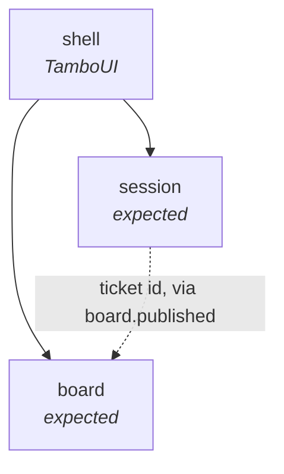

# Context map

Each bounded context is a direct subpackage of `dev.maxenceng.lazyclaude`. Boundaries are
verified by `ArchitectureTest`, so this document describes intent while the test enforces it.

## Contexts

None exists in code yet. The rows below are the expected first two, taken from what the tool
is for; each becomes real — package, glossary section and all — in the change that implements
the first ticket refined into it, and may be renamed or merged before then.

| Context | Responsibility | Status |
|---|---|---|
| `board` | A project's backlog: its tickets, their status and frontmatter, read from and written back to `docs/backlog/*.md`. | expected |
| `session` | Claude Code sessions: which are live, attaching to one, starting a new one for a ticket. | expected |

Not contexts:

| Package | Role |
|---|---|
| `shell` | The TamboUI application. Composes contexts' application services into screens and keys. |
| `shared` | Shared kernel, for types genuinely common to all contexts. Created when the first one is. |

## Relationships

The dotted edge is a guess: a session is likely started *for* a ticket, which would make the
ticket id the one thing `session` knows about `board`. Settle it when that ticket is refined.
